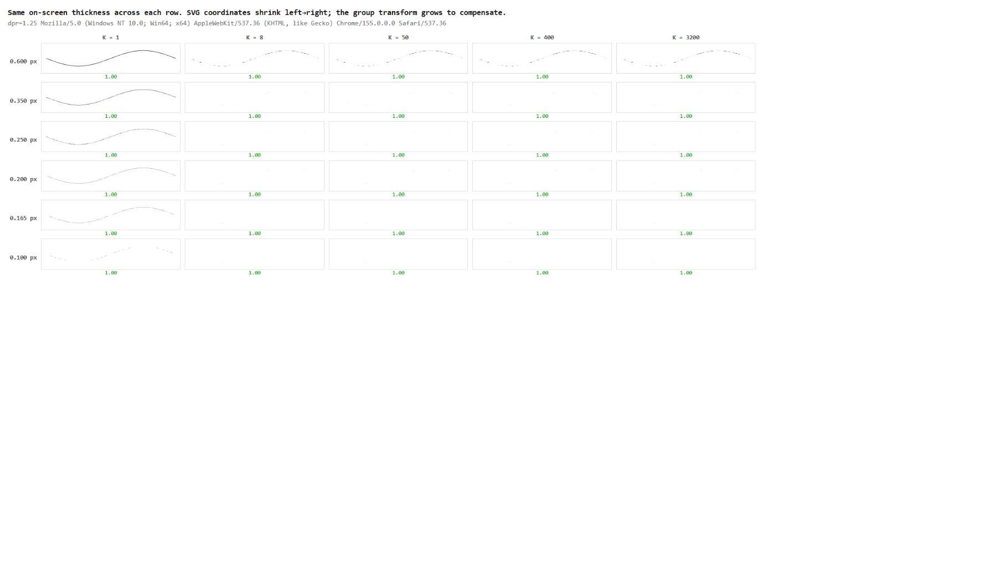

# bound.less SVG Hairline Lab

**A small browser lab for a surprising drawing-app problem: a line can disappear even when its intended on-screen size stays the same.**

While developing [bound.less](https://github.com/kobinkempe/bound.less-kk), an infinite-zoom drawing app, I needed to understand why very thin SVG strokes behaved differently at different internal coordinate scales. I isolated the symptom in a small page so comparable lines could be inspected without the rest of the application.

AI-assisted debugging helped turn the symptom into controlled experiments. The lab compares live SVG painting with a canvas control, making it easier to see when a numerical or pixel-count test misses what the browser actually displays. Open the live grid, compare its rows and then inspect the control.

## Public demo

[Open the live lab](https://kobinkempe.pages.dev/boundless-hairline-lab/) · [See project details](https://kobinkempe.pages.dev/projects/boundless-hairline-lab/)



## Run

```sh
python -m http.server 8000 --bind 127.0.0.1
```

Open http://127.0.0.1:8000 and choose the live SVG grid. No package installation, backend or API key is required.

## Experiment

`experiments/chrome.html` varies target thickness and local coordinate scale while a group transform compensates to preserve on-screen dimensions. `chrome2.html` supplies another comparison. `chrome3.html` reduces the case to four scales at a target width of 0.165 CSS px. `experiments/index.html` is a canvas measurement control.

The original investigation identified a disappearing-path region around that width in its tested Chrome environment. This is an observation from that setup, not a universal browser threshold. Canvas rasterization can disagree with live SVG paint, so a canvas pixel count alone is an insufficient visual oracle. Capture the actual page and compare at a known browser zoom and device pixel ratio.

## What it showed

This was one of the reasons bound.less now draws with its own rasterizer, which works out exactly how much of each pixel a line covers. A 0.165-pixel line then shows as a faint grey line instead of vanishing.

## Why it belongs in the portfolio

This isolates a real infinite-canvas failure into a small, shareable experiment. It shows numerical reasoning, negative controls and attention to what a test actually measures. It was developed with AI assistance; there is no model at runtime.

The portfolio cleanup adds navigation and explanation while retaining the experiment geometry. Static links and inline JavaScript are checked; Chrome screenshots confirm the live grids render. Performance, paint and device-specific behavior require fresh measurements on each target browser.

## Source

Extracted from [bound.less](https://github.com/kobinkempe/bound.less-kk). `PROVENANCE.json` maps the included experiments to their upstream paths and records the standalone snapshot hashes and adaptations.
